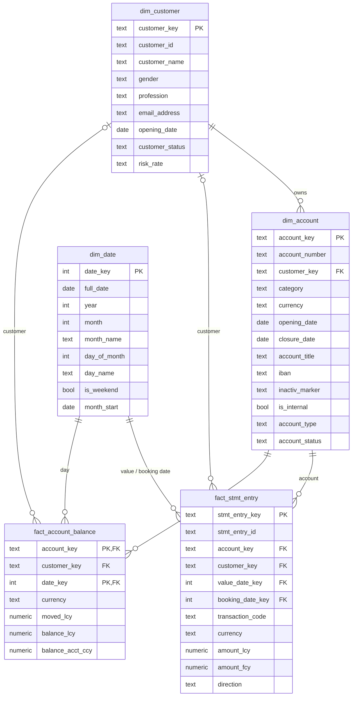

# Gold layer: star schema

Schema `dv_gold`. Facts hold the numbers, dimensions describe them.

- `fact_stmt_entry` grain: one row per statement entry
- `fact_account_balance` grain: one row per account per day
