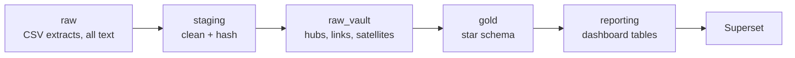

# dbt_vault: Data Vault 2.0 on T24 core banking data

A dbt project that turns raw T24 extracts (customers, accounts, statement entries) into a
Data Vault and a star schema, feeding a customer cash-flow dashboard in Superset.

## Architecture

| Layer | Schema | Built as | What it does |
|---|---|---|---|
| Bronze | `raw` | loaded manually | T24 tables exactly as extracted |
| Silver: staging | `dv_staging` | views | trims, `''` to NULL, casts, adds hash keys and hash diffs |
| Silver: raw vault | `dv_raw_vault` | incremental | keeps full history, append only |
| Gold | `dv_gold` | tables | dimensions and facts for reporting |
| Reporting | `dv_reporting` | tables | shaped for the dashboard cards and charts |

## Models

**Raw vault**
- Hubs: `hub_customer`, `hub_account`
- Links: `link_customer_account`, `link_stmt_entry` (non-historized, one row per entry)
- Satellites: `sat_customer`, `sat_account_details`, `sat_account_balance`, `sat_stmt_entry`

**Gold**
- Dimensions: `dim_customer` (current only), `dim_account`, `dim_date`
- Facts: `fact_stmt_entry` (one row per entry), `fact_account_balance` (one row per account per day)

**Reporting**
- `daily_balances`: daily in / out / balance, with month-to-date labels
- `monthly_accounts`: monthly in / out and closing balance
## Dashboard

ERDs: [silver](docs/silver_raw_vault.md) · [gold](docs/gold_star_schema.md)

